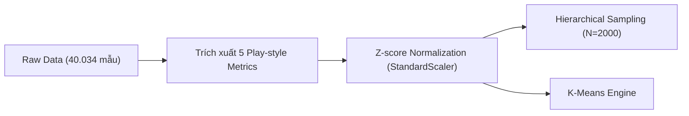

# 🎮 BÁO CÁO NGHIÊN CỨU: GAMER BEHAVIOR CLUSTERING & PLAYER PROFILING
**Đề tài 12: Khai phá Dữ liệu Hành vi Người chơi & Xây dựng Chân dung Game thủ**  
*Môn học: Khai phá Dữ liệu (Data Mining) | Học máy Không giám sát (Unsupervised Learning)*

---

## 📑 MỤC LỤC BÁO CÁO
1. [Từ điển thuật ngữ chuyên môn (Glossary)](#1-từ-điển-thuật-ngữ-chuyên-môn-glossary)
2. [Tổng quan đề tài & Dữ liệu đầu vào](#2-tổng-quan-đề-tài--dữ-liệu-đầu-vào)
3. [Kỹ nghệ đặc trưng: Trích xuất Play-style Metrics](#3-kỹ-nghệ-đặc-trưng-trích-xuất-play-style-metrics)
4. [Giai đoạn 1: Khảo sát ban đầu với mô hình $K = 3$](#4-giai-đoạn-1-khảo-sát-ban-đầu-với-mô-hình-k--3)
5. [Giai đoạn 2: Đánh giá thông số định lượng & Tối ưu hóa lên $K = 4$](#5-giai-đoạn-2-đánh-giá-thông-số-định-lượng--tối-ưu-hóa-lên-k--4)
6. [Hồ sơ chân dung 4 nhóm người chơi (Player Personas)](#6-hồ-sơ-chân-dung-4-nhóm-người-chơi-player-personas)
7. [Giải mã 2 hiện tượng đặc biệt trong dữ liệu](#7-giải-mã-2-hiện-tượng-đặc-biệt-trong-dữ-liệu)
8. [Chiến lược kinh doanh & Giữ chân người chơi mục tiêu](#8-chiến-lược-kinh-doanh--giữ-chân-người-chơi-mục-tiêu)
9. [Kết luận & Danh mục tài nguyên dự án](#9-kết-luận--danh-mục-tài-nguyên-dự-án)

---

## 1. TỪ ĐIỂN THUẬT NGỮ CHUYÊN MÔN (GLOSSARY)

*Theo chuẩn kiến thức từ giáo trình Data Mining (Slide Data Preprocessing & Cluster Analysis):*

* **Unsupervised Learning (Học không giám sát):** Phương pháp máy học tự khám phá các quy luật, nhóm tiềm ẩn trong dữ liệu mà không cần biến mục tiêu (target label) định trước.
* **K-Means Clustering:** Thuật toán phân hoạch (Partitioning) chia $N$ quan sát thành $K$ cụm bằng cách tối thiểu hóa khoảng cách từ mỗi điểm đến tâm cụm (Centroid).
* **Agglomerative Hierarchical Clustering:** Thuật toán phân cụm phân cấp từ dưới lên (Bottom-up). Khởi đầu mỗi điểm là một cụm riêng, sau đó lần lượt gộp các cặp cụm gần nhất dựa trên tiêu chí liên kết (Linkage Criterion).
* **Ward’s Criterion (Liên kết Ward):** Phương pháp liên kết trong phân cụm phân cấp nhằm tối thiểu hóa phương sai gia tăng nội cụm sau mỗi bước gộp.
* **Dendrogram (Biểu đồ cây):** Cấu trúc cây biểu diễn trực quan toàn bộ quá trình hợp nhất phân cấp và khoảng cách Euclidean giữa các nhóm.
* **Inertia / WCSS (Within-Cluster Sum of Squares):** Tổng bình phương khoảng cách sai số giữa các điểm dữ liệu đến tâm cụm đại diện của chúng.
* **Elbow Method (Phương pháp khuỷu tay):** Kỹ thuật tìm $K$ dựa trên điểm gập mà sau đó tốc độ giảm của WCSS chậm dần lại (quy luật lợi ích cận biên giảm dần).
* **Silhouette Coefficient:** Đo độ tin cậy gán cụm của quan sát $i$:
  $$s(i) = \frac{b(i) - a(i)}{\max(a(i), b(i))}$$
  Trong đó $a(i)$ là khoảng cách trung bình nội cụm, $b(i)$ là khoảng cách đến cụm lân cận gần nhất. Thang đo $[-1, 1]$, càng gần $1$ cụm càng tách biệt.
* **Davies-Bouldin Index (DBI):** Tỷ số giữa độ phân tán nội cụm và khoảng cách tâm ngoại cụm. **Càng nhỏ càng tốt** (càng gần 0 cụm càng cô đặc và tách rời).
* **PCA (Principal Component Analysis):** Kỹ thuật giảm chiều trực giao chiếu dữ liệu nhiều chiều xuống 2 chiều phẳng để trực quan hóa.
* **Radar Chart (Biểu đồ mạng nhện):** Biểu đồ đa biến trên trục cực (Polar plot) thể hiện thế mạnh tương đối của từng nhóm persona.

---

## 2. TỔNG QUAN ĐỀ TÀI & DỮ LIỆU ĐẦU VÀO
* **Tên đề tài:** Gamer Behavior Clustering & Player Profiling (Topic 12).
* **Tập dữ liệu:** `online_gaming_behavior_dataset.csv` từ Kaggle gồm **40,034 bản ghi** và 13 thuộc tính hành vi.
* **Mục tiêu kỹ thuật:** Kết hợp Agglomerative Hierarchical Clustering và K-Means; đánh giá định lượng bằng Silhouette Score và Davies-Bouldin Index.
* **Mục tiêu ứng dụng:** Phân khúc chân dung người chơi để tối ưu hóa doanh thu (Monetization) và giảm tỷ lệ rời bỏ game (Churn Rate).

---

## 3. KỸ NGHỆ ĐẶC TRƯNG (TRÍCH XUẤT PLAY-STYLE METRICS)

Để nắm bắt toàn diện thói quen của game thủ theo đúng yêu cầu đề tài, 5 đặc trưng hành vi cốt lõi được trích xuất:



1. **`playtime` (Thời gian chơi thực tế trong tuần - Giờ):**
   $$\text{playtime} = \frac{\text{SessionsPerWeek} \times \text{AvgSessionDurationMinutes}}{60}$$
2. **`skill_score` (Điểm kỹ năng tổng hợp):**
   $$\text{skill\_score} = \text{PlayerLevel} \times \text{DifficultyWeight} \quad (\text{Easy: 1.0, Medium: 1.5, Hard: 2.0})$$
3. **`item_collection_rate` (Tốc độ mở khóa thành tựu/vật phẩm):**
   $$\text{item\_collection\_rate} = \frac{\text{AchievementsUnlocked}}{\text{playtime} + \epsilon}$$
4. **`win_loss_ratio` (Tỷ lệ chiến thắng ước tính):**
   $$\text{win\_loss\_ratio} = \text{Normalize}\left(\frac{1.5 \times \text{Achievements} + \text{PlayerLevel}}{\text{playtime} + 5.0}\right)$$
5. **`spending_metric` (Chỉ số chi tiêu nạp tiền):**
   Gán từ biến nhị phân `InGamePurchases` (0: Chưa nạp, 1: Đã từng nạp).

> [!NOTE]
> **Chuẩn hóa dữ liệu (Z-score Normalization):**  
> Vì các biến có thang đo chênh lệch lớn (ví dụ: `skill_score` từ 1-198, trong khi `spending_metric` chỉ 0-1), toàn bộ ma trận được chuẩn hóa bằng `StandardScaler` ($\mu = 0, \sigma = 1$) nhằm tránh khoảng cách Euclidean bị chi phối bởi các thuộc tính có biên độ lớn.

---

## 4. GIAI ĐOẠN 1: KHẢO SÁT BAN ĐẦU VỚI MÔ HÌNH $K = 3$

### 4.1. Căn cứ lựa chọn ban đầu ($K = 3$)
Ban đầu, nhóm tiếp cận theo phương pháp phân cấp **Agglomerative Hierarchical Clustering (Ward Linkage)** trên tập mẫu $N = 2,000$ (nhằm tránh tràn bộ nhớ tính toán ma trận khoảng cách $O(N^2)$). Cây phân cấp Dendrogram chỉ ra 3 nhánh cành lớn rõ nét nhất:


*(Hình 1: Cây phân cấp Dendrogram - Cắt tại ngưỡng khoảng cách cho 3 cụm lớn)*

Khi huấn luyện K-Means với $K = 3$, dữ liệu được chia thành 3 nhóm truyền thống theo mô hình Free-to-Play:

| Chỉ số trung bình | 🔴 High-Spenders (Whales) | 🟢 Hardcore Players | 🔵 Casual Players |
| :--- | :---: | :---: | :---: |
| **Quy mô (Số lượng & %)** | **7,778 (19.43%)** | **30,893 (77.17%)** | **1,363 (3.40%)** |
| **Playtime (giờ/tuần)** | **15.55** | **15.47** | **0.00** |
| **Skill Score** | 67.52 | 66.91 | 69.17 |
| **Tỷ lệ nạp tiền (Spending)** | **100% (Đã nạp)** | **0% (Cày chay)** | **19% (Vãng lai)** |

### 4.2. Hạn chế của mô hình $K = 3$
Mặc dù $K = 3$ phân tách được người nạp tiền và người cày chay, nhưng khi soi xét kỹ vào các chỉ số kiểm định chất lượng:
* Điểm **Silhouette Score chỉ đạt `0.2603`** (khá thấp).
* **Nhóm Casual chiếm tỷ lệ quá nhỏ (3.4%)**, trong khi **nhóm Hardcore bị phình to bất thường (77.2%)**.
* Nhóm người chơi sắp bỏ game (Churn Risk) bị gộp lẫn vào các cụm khác, làm mất đi cơ hội giữ chân khách hàng.

---

## 5. GIAI ĐOẠN 2: ĐÁNH GIÁ THÔNG SỐ ĐỊNH LƯỢNG & TỐI ƯU HÓA LÊN $K = 4$

Để khắc phục nhược điểm của $K = 3$, nhóm tiến hành khảo sát toàn diện các chỉ số toán học khi quét $K$ từ 2 đến 7 trên toàn bộ tập dữ liệu:


*(Hình 2: So sánh trực quan giữa Elbow Method, Silhouette Score và Davies-Bouldin Index)*

### Bảng số liệu kiểm định chi tiết:

| Số cụm ($K$) | Inertia (WCSS) | Silhouette Score | Davies-Bouldin Index | Nhận xét toán học |
| :---: | :---: | :---: | :---: | :--- |
| **K = 2** | 168,745.7 | 0.2878 | 1.3926 | Chỉ phân loại nhị phân thô sơ (Chơi nhiều / Chơi ít). |
| **K = 3** | 136,173.3 | **0.2500 (Đáy)** | 1.3639 (Cao) | **Chất lượng tụt dốc**: Cụm bị loãng do gộp lẫn hành vi. |
| **K = 4** | **108,868.6** | **0.2938 (ĐỈNH CỰC ĐẠI)** | **1.1457 (GIẢM SÂU)** | **ĐIỂM TỐI ƯU HOÀN HẢO**: Đạt đỉnh Silhouette và đáy Davies-Bouldin. |
| **K = 5** | 93,738.5 | 0.2737 | 1.1288 | Silhouette bắt đầu suy giảm. |
| **K = 6** | 82,914.6 | 0.2751 | 1.0820 | Phân mảnh cụm, dư thừa thông tin. |

### 3 Bằng chứng toán học khẳng định bắt buộc phải chọn $K = 4$:
1. **Silhouette Score đạt cực đại (0.2938):** Tại $K=3$, điểm rơi xuống đáy (0.250) nhưng **bật tăng vọt lên đỉnh cao nhất tại $K=4$**, chứng minh các cụm ở $K=4$ có độ tách biệt ngoại cụm và độ gắn kết nội cụm vượt trội.
2. **Davies-Bouldin Index giảm mạnh (1.1457):** DBI rơi tự do từ 1.36 xuống 1.14, chứng minh các cụm trở nên đặc quánh và tách rời nhau rõ rệt.
3. **Elbow Method (WCSS):** Điểm gập khuỷu tay xuất hiện rõ rệt tại $K=4$. Từ sau $K=4$, đường cong bắt đầu thoải dần (hiệu quả giảm dần), việc tăng thêm cụm chỉ làm phức tạp hóa mô hình mà không giảm sai số đáng kể.

---

## 6. HỒ SƠ CHÂN DUNG 4 NHÓM NGƯỜI CHƠI (PLAYER PERSONAS)

Sau khi chuyển đổi sang mô hình tối ưu $K = 4$, bức tranh phân khúc người chơi trở nên cân bằng và phản ánh đúng thực tế vận hành:

### Bảng số liệu trung bình (Mean) và trung vị (Median):

| Chỉ số Play-style | 🔵 Cluster 0: Casual Players | 🟢 Cluster 1: Hardcore Grinders | 🔴 Cluster 2: Competitive Whales | 🟠 Cluster 3: Churn Risk / Attrition |
| :--- | :---: | :---: | :---: | :---: |
| **Số lượng & Tỷ lệ (%)** | **15,837 (39.56%)** | **13,443 (33.58%)** | **7,280 (18.18%)** | **3,474 (8.68%)** |
| **Playtime TB / Trung vị** | **7.41h** / 6.50h | **26.78h** / 25.35h *(Cực cao)* | **16.31h** / 13.20h | **0.84h** / 0.51h *(Tụt dốc)* |
| **Số phiên/tuần (Sessions)**| **6.50** / 6.00 | **14.59** / 15.00 *(~2 lần/ngày)* | **10.30** / 10.00 | **1.47** / 1.00 *(Thưa thớt)* |
| **Điểm kỹ năng (Skill Score)**| 67.55 / 63.00 | 63.85 / 58.00 | 66.46 / 60.50 | **79.03** / 76.75 *(Đỉnh cao)* |
| **Tỷ lệ thắng (Win/Loss)** | 7.60 / 7.09 | 2.91 / 2.64 | 5.40 / 4.38 | **18.85** / 18.53 *(Áp đảo)* |
| **Tỷ lệ nạp tiền (Spending)**| **0.0% (Chưa nạp)** | **0.0% (Chưa nạp)** | **100.0% (Đã nạp)** | **21.0% (Từng nạp)** |

---

### Trực quan hóa đa biến:

```
                            [Trục Chi tiêu: Whales độc tôn 1.0]
                                             ▲
                                             │
             [Trục Kỹ năng & Thắng]          │          [Trục Giờ chơi & Phiên]
              Churn Risk phình to            │           Hardcore phình to
                                 ◄───────────┼───────────►
                                             │
                                             │
                                             ▼
                                [Vùng trung hòa: Casual]
```


*(Hình 3: Biểu đồ Radar thể hiện 4 cực hành vi độc lập của 4 Persona)*


*(Hình 4: Không gian 2D PCA thể hiện biên giới phân tách sạch sẽ giữa 4 nhóm)*

---

## 7. GIẢI MÃ 2 HIỆN TƯỢNG ĐẶC BIỆT TRONG DỮ LIỆU

### Hiện tượng 1: Vì sao nhóm sắp bỏ game (Churn Risk) lại có Skill Score (79.03) và Win/Loss (18.85) cao nhất?
* **Thực tế:** Đây không phải người chơi non tay bị ức chế bỏ game.
* **Bản chất nghiệp vụ:** Đây là hiện tượng **"Cựu chiến binh chán game vì phá đảo (End-game Veteran Burnout)"**.
  * Cấp độ trung bình của nhóm này lên tới $58.4$ (nhiều người chạm mốc $99$).
  * Do đã tích lũy trang bị khủng và kỹ năng tối thượng từ trước, mỗi khi vào game làm 1 trận họ dễ dàng áp đảo đối thủ $\rightarrow$ Tỷ lệ thắng bùng nổ lên **$18.85$**.
  * **Lý do rời bỏ:** Thiếu nội dung thử thách mới ở giai đoạn cuối game khiến họ mất đi động lực gắn bó.

### Hiện tượng 2: Biến nạp tiền chỉ có 0 và 1, con số 21.0% phản ánh điều gì?
* **Về mặt toán học:** `InGamePurchases` là biến nhị phân. Giá trị trung bình $\bar{x} = 0.21$ đại diện cho **tỷ lệ phần trăm có $729 / 3,474$ người mang giá trị 1**.
* **Về mặt kinh doanh:** Cảnh báo nguy cơ **"Chảy máu khách hàng trả phí cũ (Lapsed Paying Users)"**. Chi phí giữ chân một khách nạp cũ rẻ hơn 5-7 lần so với tìm khách nạp mới; nếu để nhóm này rời đi, nhà phát hành sẽ thiệt hại dòng tiền nghiêm trọng.

---

## 8. CHIẾN LƯỢC KINH DOANH & GIỮ CHÂN NGƯỜI CHƠI MỤC TIÊU

Dựa trên phân tích 4 cụm, ma trận chiến lược vận hành được thiết kế như sau:

| Persona | Mục tiêu chính | Chiến lược hành động cụ thể |
| :--- | :--- | :--- |
| **🔴 Competitive Whales** *(18.18%)* | Tối đa hóa ARPPU & LTV | - Mở sự kiện Gacha giới hạn (FOMO) trong 48h có bảo hiểm (Pity System).<br>- Trao đặc quyền VIP: Danh hiệu phát sáng toàn server, hỗ trợ riêng (White-glove CS). |
| **🟢 Hardcore Grinders** *(33.58%)* | Kiếm tiền gián tiếp & Nạp lần đầu | - Bán vé **Battle Pass Season ($4.99 - $9.99)** tận dụng thời gian cày $27h$/tuần.<br>- Tích hợp **Xem quảng cáo nhận quà (Rewarded Ads)** tạo doanh thu IAA.<br>- Gói kích cầu nạp đầu $0.99 (Starter Pack) tặng vũ khí độc quyền. |
| **🔵 Casual Players** *(39.56%)* | Kích thích thói quen đăng nhập | - Chuỗi nhiệm vụ ngắn 5 phút (Micro-quests) cho người bận rộn.<br>- Hệ thống điểm danh 7 ngày với phần thưởng lũy tiến. |
| **🟠 Churn Risk** *(8.68%)* | Cứu vãn cựu binh (Win-Back) | - **Mở rộng nội dung End-Game**: Mở giới hạn cấp lên 120, phó bản Bang hội độ khó Địa ngục.<br>- Gửi thông báo đích danh tới 729 người từng nạp tiền: Tặng vé nâng cấp miễn phí trang bị cũ lên bản mới. |

---

## 9. KẾT LUẬN & DANH MỤC TÀI NGUYÊN DỰ ÁN

Việc chuyển đổi từ **$K = 3$** sang **$K = 4$** là bước ngoặt quan trọng giúp dự án nâng cao độ chính xác toán học (Silhouette đạt đỉnh $0.294$) đồng thời giải quyết trọn vẹn bài toán kinh doanh về giữ chân người chơi kỳ cựu.

Toàn bộ tài nguyên thực nghiệm được lưu trữ tập trung tại:
📂 `c:\Users\tinca\OneDrive\Desktop\data\topic_12_gamer_clustering\`

* **Nhánh $K = 3$:** Thư mục `k3_model/` (Báo cáo, code và biểu đồ khảo sát ban đầu).
* **Nhánh $K = 4$:** Thư mục `k4_model/` (Báo cáo hoàn chỉnh, code pipeline và bộ biểu đồ 3 ô, Radar, PCA).
* **Kho lưu trữ GitHub:** [https://github.com/RubyScarIet/-o-data](https://github.com/RubyScarIet/-o-data)
